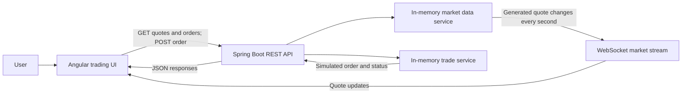

# Rukamini Trade

Rukamini Trade is a learning/demo stock-trading application. It pairs an Angular trading interface with a Spring Boot backend that generates sample NSE quotes, streams quote updates, and accepts simulated orders.

> **Demo only:** This project does not connect to a stock exchange or broker. Market prices are generated, orders are kept in memory, and the browser login is not real authentication. Do not use it for real trading or expose it publicly as-is.

## What the project does

- Shows a trading dashboard with market quotes and trading-oriented navigation for watchlists, orders, positions, holdings, and related tools.
- Seeds sample quotes for RELIANCE, TCS, INFY, HDFCBANK, ICICIBANK, and TATAMOTORS.
- Simulates price movements and publishes quote updates to connected browsers in real time.
- Accepts market and limit order requests for known symbols and displays their simulated status.
- Provides a browser-only demo sign-in flow to enter the trading UI.

## Technology

| Area | Technology |
| --- | --- |
| Frontend | Angular 22, TypeScript 6, Angular Material/CDK, RxJS |
| Backend | Java 17, Spring Boot 4, Spring MVC, Spring WebSocket, Spring Security, Jackson |
| Build tools | npm/Angular CLI and Maven |
| Optional container setup | Docker and Docker Compose configuration for the backend |

## How data flows



1. The Angular app loads quotes and the order list using HTTP.
2. The backend's market service starts with six sample quotes and updates them once per second with generated price changes.
3. The backend broadcasts updated quotes as JSON over WebSocket; the UI updates its quote state when messages arrive.
4. The user submits a buy or sell order. The backend validates the symbol, side, quantity, order type, and price, then returns a simulated order.
5. Market orders are marked `COMPLETE`; limit orders are marked `OPEN`. This demo does not match orders against a market.

## Repository layout

```text
.
├── src/
│   ├── main/java/com/rukamini/trade/
│   │   ├── config/       # CORS and Spring Security configuration
│   │   ├── controller/   # REST API and root redirect
│   │   ├── market/       # Sample quotes, WebSocket stream, quote models
│   │   └── trading/      # Order model and simulated order service
│   └── main/resources/   # Spring Boot configuration
├── stock-trading-ui/
│   └── src/app/
│       ├── core/         # Authentication and API/WebSocket clients
│       ├── features/     # Login, dashboard, chart, watchlist, and trading views
│       └── layout/       # Shared application layout
├── Dockerfile
└── compose.yaml
```

## Run locally

You will need JDK 17, Maven, Node.js, and npm.

### Start the backend

From the repository root:

```bash
mvn spring-boot:run
```

The backend listens on port `8080` by default. Its configuration is in `src/main/resources/application.properties`.

### Start the frontend

In a second terminal:

```bash
cd stock-trading-ui
npm ci
npm start
```

Open [http://localhost:4200](http://localhost:4200). The demo login accepts any non-empty user ID and a password of at least six characters; it stores a session flag in browser session storage and does not contact a backend authentication service.

### Backend and frontend URL note

The backend currently sets `server.servlet.context-path=/login`. Therefore, its REST endpoints are served under `/login/api` and its WebSocket endpoint under `/login/ws/market` by default. The Angular services currently connect to `/api` and `/ws/market` on `localhost:8080`, without that `/login` prefix.

For the current Angular defaults to reach the backend, run Spring Boot with an empty servlet context path (remove or override `server.servlet.context-path=/login` in `application.properties`). Alternatively, update the Angular service URLs to include the configured context path. The backend's allowed frontend origin defaults to `http://localhost:4200`; set `FRONTEND_ORIGIN` if the UI uses another origin.

## API

With the default backend context path (`/login`):

| Method | Path | Purpose |
| --- | --- | --- |
| `GET` | `/login/api/market/quotes` | Get the current sample quotes |
| `GET` | `/login/api/orders` | Get simulated orders, newest first |
| `POST` | `/login/api/orders` | Validate and place a simulated order |
| WebSocket | `/login/ws/market` | Receive quote updates as JSON messages |

Example order request:

```json
{
  "symbol": "RELIANCE",
  "side": "BUY",
  "quantity": 1,
  "orderType": "MARKET",
  "price": 2980.0
}
```

Supported sides are `BUY` and `SELL`; supported order types are `MARKET` and `LIMIT`. Quantity must be between 1 and 100000. The symbol must be in the sample market data. A limit order requires a positive price.

## Configuration

The backend reads these environment-backed settings:

| Setting | Default | Purpose |
| --- | --- | --- |
| `SERVER_PORT` | `8080` | HTTP server port |
| `FRONTEND_URL` | `http://localhost:4200` | Destination for the backend root redirect |
| `API_BASE_PATH` | `/api` | REST API base path |
| `FRONTEND_ORIGIN` | Frontend URL | Allowed CORS and WebSocket origin |
| `MARKET_WEBSOCKET_PATH` | `/ws/market` | WebSocket endpoint |
| `TRADE_API_ENABLED` | `true` | Allows the demo trade API without authentication |

The servlet context path is configured separately as `server.servlet.context-path` in `application.properties` and defaults to `/login`.

## Scope and current limitations

- **Synthetic market data:** quotes are seeded locally and prices change randomly; there is no live market-data provider.
- **Simulated orders:** orders are validated and recorded in process memory only. A market order is immediately labeled complete; a limit order remains open. There is no exchange, broker, account, balance, or execution integration.
- **No persistence:** quotes and orders are not stored in a database and are lost when the backend restarts.
- **Demo-only authentication:** sign-in is checked only in the browser. It is not identity verification, authorization, or a secure backend session.
- **Development security defaults:** `TRADE_API_ENABLED=true` permits the trade API without authentication. The current configuration is not suitable for public or production deployment.
- **Frontend/API path mismatch:** the backend's default `/login` context path does not match the paths currently used by the Angular HTTP and WebSocket clients. See the local run note above.
- **Container setup:** the provided Dockerfile is for the Spring Boot backend. It copies `mvnw` and `.mvn/`, which are not currently included in this repository; container builds need a Maven wrapper or a corresponding Dockerfile adjustment.
- **Testing:** run the frontend and backend test commands below; add tests as the application grows.

## Build and test

Backend (from the repository root):

```bash
mvn test
mvn package
```

Frontend (from `stock-trading-ui/`):

```bash
npm test
npm run build
```

## Potential next steps

- Align configurable frontend API/WebSocket URLs with the backend context path.
- Add backend authentication and authorization before enabling non-demo trading routes.
- Add database persistence and explicit order lifecycle/execution behavior.
- Integrate an authorized market-data source or broker sandbox.
- Expand backend and frontend test coverage, then add end-to-end tests.
- Update the container build to use the available Maven installation or commit a Maven wrapper.
